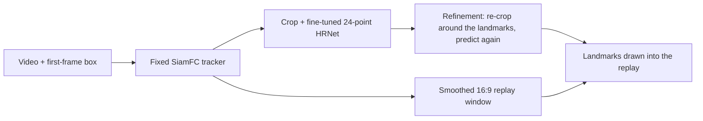

# Skier tracking and 2D body-and-ski landmark estimation

CS230 project, Fall 2026 · Ruichao Zhang (ruichaoz@stanford.edu)

Given a single-camera skiing video and a box around the skier in the first frame, the system:
- tracks the skier with a fixed, pretrained SiamFC;
- predicts **24 landmarks** (14 body, 8 ski, 2 pole) with a fine-tuned COCO HRNet-W32 on a crop around the tracker box;
- predicts again on a crop around those landmarks (**pose-guided crop refinement**, D26);
- produces a smooth, skier-centered 16:9 replay with the skeleton drawn on it.

The learning study asks whether targeted augmentation (crop jitter, motion blur, occlusion) improves ski-landmark accuracy and robustness to imperfect crops. Proposal: `skier_proposal.pdf`. Plan: `skier_implementation_plan.md`.



## Status (2026-11-12)

**All steps are done, and the test set was evaluated once on 2026-11-12 (D27).** The final report is due Fri 2026-11-20 (`final_report/`).

- **Results:** `results/step8/test/tables.md` (test), `results/step8/followcam/tables.md` (follow-cam set), `results/step8/val/tables.md` (val, which chose every setting).
  - E2 on test, reference crops: ski PCK@0.1 94.8%, body 95.9%.
  - Tracker crops cost 28.0 ski points; refinement recovers +9.3 [6.7, 12.1] of them, with no retraining.
  - SiamFC on 471 SkiTB test clips: mean IoU 0.404, toolkit F-score 0.406.
- **Decisions:** D1–D27 in `docs/decisions.md`; running notes in `PROJECT_NOTES.md`.
- **Tests:** 321 pass on the GPU machine (a Windows laptop with WSL2, D17; `docs/laptop_setup.md`). Without torch and mmpose, 12 skip.

## Setup

**Light environment (any machine; enough for every unit test):**

```bash
python3.10 -m venv .venv && source .venv/bin/activate
pip install -e ".[dev]"          # numpy<2, opencv-python, pillow, pyyaml, pytest
pytest -q                        # torch/stack/gpu tests skip without those packages
```

**GPU environment:** the pinned stack is torch 2.1.2 + cu121, mmcv 2.1.0, mmengine 0.10.x, mmpose 1.3.2, numpy < 2; the pins are listed in `requirements-pose.txt`.
- **Windows laptop (current, D17):** WSL2 Ubuntu 22.04, step by step in `docs/laptop_setup.md`.
- **AWS g5.xlarge (later):** install exactly as in `skier_step_1_guide.md` §1C.7.
- Then run the full test suite, **before any training**.
- `python scripts/check_env.py --strict` must pass.

**Paths:** data and results live outside the repo. Set `SKIER_DATA` (default `~/skier_data`) and `SKIER_RESULTS` (default `~/skier_results`).

## Data

**Ski 2DPose** (Bachmann et al., 3DV 2019): public, no form needed.

```bash
mkdir -p $SKIER_DATA/ski2dpose/archives && cd $SKIER_DATA/ski2dpose/archives
B=https://datasets-cvlab.epfl.ch/2019-ski-2d-pose
for f in ski2dpose_labels.json.zip ski2dpose_images_jpg.zip ski2dpose_videos.zip ski2dpose_info.json; do curl -fLO "$B/$f"; done
cd .. && mkdir labels images videos
unzip -q archives/ski2dpose_labels.json.zip -d labels
unzip -q archives/ski2dpose_images_jpg.zip -d images
unzip -q archives/ski2dpose_videos.zip -d videos
```

- Compare the SHA-256 values with `docs/data_audit_ski2dpose.md`.
- The expected counts are 16 videos, 158 segments and 1,982 images.

**SkiTB** (Dunnhofer et al., WACV 2024; CC BY-NC 4.0): access by form. Only the alpine (`AL/`) data is used.
- Put it at `$SKIER_DATA/skitb/` (so `$SKIER_DATA/skitb/AL/AL0001/…`) and pass `--skitb-root $SKIER_DATA/skitb`.
- The split file is `AL/AL_train_val_test_athlete_60-40.json` (D15).
- Layout, digests and findings: `docs/data_audit_skitb.md`.

Dataset images and labels are **never** committed. The repo holds only manifests and small text evidence.

## Running the pipeline

Every tool has `--help`. Outputs go under `$SKIER_RESULTS` unless `--out` is given. `L` stands for `$SKIER_DATA/ski2dpose/labels/ski2dpose_labels.json`, and `I` for `$SKIER_DATA/ski2dpose/images`.

| Stage | Command |
| --- | --- |
| Label audit and inventory | `python scripts/audit_pose_labels.py $L --info $SKIER_DATA/ski2dpose/archives/ski2dpose_info.json --images-root $I` |
| Ground-truth overlays (pilot videos) | `python scripts/draw_gt_overlays.py --inventory data/manifests/pose_inventory.csv --labels $L --images-root $I --videos-file data/manifests/pilot_videos.txt` |
| Video-frame alignment | `python scripts/check_alignment.py --inventory data/manifests/pose_inventory.csv --images-root $I --video-id VID --segment-id SEG --labels $L` |
| **Freeze the pose split** | `python scripts/make_pose_split.py --set-aside followcam=auto` → `data/manifests/pose_split_v1.json` |
| Environment check (AWS) | `python scripts/check_env.py --strict` |
| MMPose cross-check (≤ 2 px) | `python scripts/crosscheck_mmpose.py --config CFG --checkpoint COCO.pth` |
| E0: generic COCO model | `python scripts/eval_generic_pose.py --config CFG --checkpoint COCO.pth --split data/manifests/pose_split_v1.json` |
| Tracker | `python scripts/run_tracker.py --siamfc-repo DIR --weights siamfc_alexnet_e50.pth --pilot-segments` (or `--skitb-root … --split-json … --partition val --fps N`) |
| Centered replay | `python scripts/make_replay.py --track-csv CLIP.csv --video CLIP.mp4` (τ/k grid on val: `--grid …`) |
| E1 training | `python scripts/train_pose.py --split data/manifests/pose_split_v1.json --hrnet-config CFG --checkpoint COCO.pth` (first `--overfit 32`, then `--profile-steps 200`) |
| E2–E4 training | the same, plus `--config configs/pose/e2.yaml --experiment E2` (likewise E3, E4); extra seeds: `--seed 231` |
| Augmentation preview (pilot images) | `python scripts/show_augmentations.py` → `$SKIER_RESULTS/pose/aug_preview/` |
| **Freeze the crop-error set** (after the split) | `python scripts/make_crop_error_set.py` → `data/manifests/crop_error_set_v1.json` |
| Evaluate a checkpoint (val) | `python scripts/eval_pose.py --checkpoint $SKIER_RESULTS/pose/E2/best.pt --hrnet-config CFG --split data/manifests/pose_split_v1.json --crop-error-set data/manifests/crop_error_set_v1.json` |
| Compare experiments | `python scripts/compare_experiments.py E0=…/E0/val/metrics.json E1=…/E1/eval/val/metrics.json E2=… E3=… E4=…` (table + D16 selection rule) |

`CFG` and `COCO.pth` come from `mim download mmpose --config td-hm_hrnet-w32_8xb64-210e_coco-256x192 --dest $SKIER_DATA/pretrained`.

## Reproducing the reported results

On the GPU machine, inside Ubuntu, with the data in `$SKIER_DATA` and the vendored SiamFC fork and weights in `$SKIER_DATA/vendor/siamfc_pytorch` (`docs/laptop_setup.md`). Each training run takes about 40 minutes on an RTX 4070.

```bash
SPLIT=data/manifests/pose_split_v1.json
CFG=$SKIER_DATA/pretrained/td-hm_hrnet-w32_8xb64-210e_coco-256x192.py
COCO=$SKIER_DATA/pretrained/td-hm_hrnet-w32_8xb64-210e_coco-256x192-81c58e40_20220909.pth
SIAM="--siamfc-repo $SKIER_DATA/vendor/siamfc_pytorch --weights $SKIER_DATA/vendor/siamfc_pytorch/pretrained/siamfc_alexnet_e50.pth"

# 1. Augmentation study (D21): E1-E4, seeds 230 and 231, 150 fine-tune epochs (set in configs/pose/e*.yaml)
for e in 1 2 3 4; do for s in 230 231; do
  python scripts/train_pose.py --split $SPLIT --hrnet-config $CFG --checkpoint $COCO \
    --config configs/pose/e$e.yaml --experiment E$e --seed $s --out $SKIER_RESULTS/pose/d21/E$e-s$s
done; done
# then evaluate each on val (scripts/eval_pose.py) and apply the D16 rule (scripts/compare_experiments.py): picks E2

# 2. Val-only choices (Step 7; each by a rule written in advance, D24 and D26)
python scripts/check_tracker_confidence.py --track-dir TRACKS --skitb-root $SKIER_DATA/skitb \
  --split-json $SKIER_DATA/skitb/AL/AL_train_val_test_athlete_60-40.json      # confidence signal and threshold
python scripts/eval_propagation.py --split $SPLIT --partition val --usable USABLE.json --track-dir TRACKS2D \
  --checkpoint E2-s230=$SKIER_RESULTS/pose/d21/E2-s230/best.pt ... --hrnet-config $CFG --refine-grid
                                                    # k_pose grid and the 12-setting refinement grid

# 3. The frozen evaluation: the identical chain on val, then test once (refuses a second run)
bash results/step8/run_final.sh val
bash results/step8/run_final.sh test

# 4. One clip end to end, with refinement on (configs/integration/default.yaml)
python scripts/process_clip.py --skitb-clip AL0027/3 --skitb-root $SKIER_DATA/skitb \
  --split-json $SKIER_DATA/skitb/AL/AL_train_val_test_athlete_60-40.json --partition val $SIAM \
  --checkpoint $SKIER_RESULTS/pose/d21/E2-s230/best.pt --hrnet-config $CFG --out $SKIER_RESULTS/final/demos/AL0027__3
```

- `run_final.sh` writes `freeze.json` (hashes of the splits, configs and checkpoints) before any output, and checks that the tree is clean and equal to `origin/main`.
- Report figures: `milestone/figures/*.py` and `final_report/figures/*.py`. The qualitative figure shows dataset frames, so it is not committed.

## Evaluation protocol (summary)

The full definitions are in `docs/evaluation_protocol.md`.

- **Split:** whole source videos only. The plan's dry run gives train 65% / val 16% / test 19%. The 6 follow-cam videos form a separate evaluation set that is never trained on (D11). The split is frozen before any model is scored.
- **Pose:** PCK@0.1 (and @0.05 for skis), normalized by the diagonal of the reliable body + ski box. Body and ski are reported separately; a missing prediction counts as a miss; hits and totals are always reported.
- **Tracking:** mean IoU on visible frames (excluding the initialization frame), a success curve, and failure episodes.
- **Replay:** containment (ski endpoints separately), centering, crop acceleration and zoom, always reported together.
- **Usage:** all tuning happens on val. Test is evaluated once (done 2026-11-12, D27).
- **Intervals:** a cluster bootstrap over segments within videos (Ski 2DPose) or sequences (SkiTB), 10,000 resamples (D25); the follow-cam set resamples its 6 videos, each one segment (D27).

## Repository layout

| Path | Contents |
| --- | --- |
| `src/skier/` | The package: `data/`, `pose/`, `tracking/`, `replay/`, `integration/` (confidence, propagation, refinement, one-clip pipeline), `eval/` (metrics, bootstrap, SkiTB toolkit port), `report/` (tables, figures), plus `geometry`, `schema`, `splits`, `viz` |
| `scripts/` | Command-line entry points (thin wrappers) |
| `configs/` | `ski24_schema.json`, `pose/e1.yaml`–`e4.yaml`, `replay/default.yaml`, `integration/default.yaml` |
| `data/manifests/` | `pose_inventory.csv`, `pilot_videos.txt`, the frozen `pose_split_v1.json` and `crop_error_set_v1.json`, `skitb_fps_v1.csv` |
| `docs/` | `scope.md`, `decisions.md`, `data_audit_ski2dpose.md`, `data_audit_skitb.md`, `evaluation_protocol.md`, `laptop_setup.md` |
| `tests/` | Unit tests on synthetic data (`tests/synth.py`) |
| `results/` | Small committed evidence per step (`results/step8/{val,test,followcam}/` for the final numbers); large outputs stay under `$SKIER_RESULTS` |
| `milestone/`, `final_report/` | The CS230 milestone and final report (LaTeX, figures and the scripts that draw them) |
| `skier_implementation_plan.md`, `skier_step_1_guide.md`, `skier_step_1_code_spec.md`, `PROJECT_NOTES.md` | The plan, the setup guide, the Step 1 spec, and the running notes |

## References

- R. Bachmann, J. Spörri, P. Fua, H. Rhodin. *Motion capture from pan-tilt cameras with unknown orientation.* 3DV 2019 (Ski 2DPose).
- M. Dunnhofer, L. Sordi, N. Martinel, C. Micheloni. *Tracking skiers from the top to the bottom.* WACV 2024 (SkiTB).
- K. Sun, B. Xiao, D. Liu, J. Wang. *Deep high-resolution representation learning for human pose estimation.* CVPR 2019 (HRNet).
- L. Bertinetto et al. *Fully-convolutional siamese networks for object tracking.* ECCV Workshops 2016 (SiamFC).
- MMPose Contributors. *OpenMMLab pose estimation toolbox and benchmark*, 2020.
