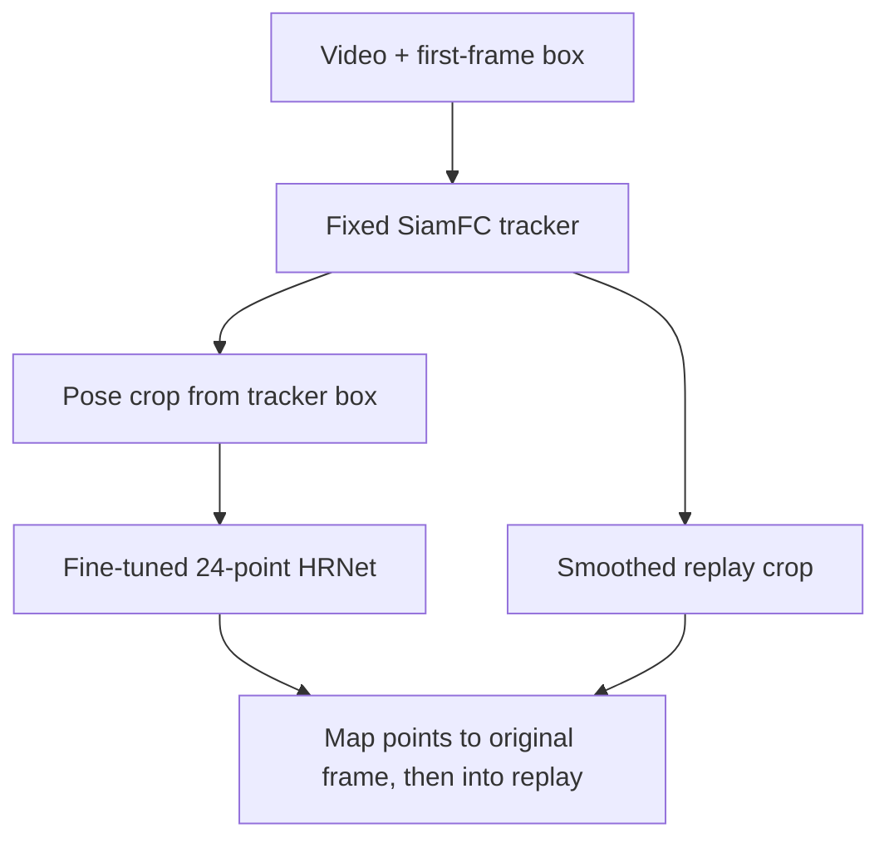

# Skier project: six-week implementation plan (v2)

**Owner:** Ruichao Zhang — ruichaoz@stanford.edu
**Plan version:** v2, October 17, 2026 (replaces v1; v1 is in git history). Status updated 2026-10-18.
**Budget:** one person, about 20 working hours per week. The original six weeks (120 h) are now **5 weeks, finishing Fri 2026-11-20** (D14; schedule in §4)
**Companion:** [README](README.md) (setup and commands), [Step 1 guide](skier_step_1_guide.md) (setup, AWS, data checks), [Step 1 code spec](skier_step_1_code_spec.md) (module contracts and tests for 1A/1B), [PROJECT_NOTES.md](PROJECT_NOTES.md) (running notes), [docs/decisions.md](docs/decisions.md) (decision log), and [CLAUDE.md](CLAUDE.md) (working rules for Claude sessions)

Hyperparameters, runtimes and costs below are starting estimates, not measured values. Nothing has been trained or measured on a GPU yet.

## Status and next actions (2026-10-24)

**Deadline: Friday 2026-11-20** (D14). The week-by-week schedule is in §4.

The **offline code for Steps 1–6 is written and tested**, ahead of the schedule in §4. That covers 250 unit tests; 9 more (`torch`, `stack`) run on the GPU machine. **The laptop gate, smoke test and MMPose cross-check passed on 2026-10-24** (259 tests; cross-check mean 0.014 px). Both datasets are on the Mac and audited:
- Ski 2DPose: 0 problems (`docs/data_audit_ski2dpose.md`).
- SkiTB `AL/`: arrived 2026-10-18, 0 format problems, reader layout confirmed (`docs/data_audit_skitb.md`, D15).

What's left needs the GPU or Ruichao, plus SkiTB's frame rate for each sequence.

**GPU machine (D17):** Ruichao's Windows laptop (RTX 4070, WSL2; setup in `docs/laptop_setup.md`) for now. The AWS account's verification is still in progress: its GPU-quota request was rejected automatically, and the Standard quota is 1 vCPU. AWS stays for heavier or parallel work once verified; reapply for the quotas then.

| Step | Code | Still to run | Blocked on |
| --- | --- | --- | --- |
| 1 | Done | ~~Overlay review (1F)~~ passed 2026-10-24; ~~alignment check (1G)~~ exact, offset 0 (2026-10-26); ~~smoke tests (1H)~~ pose 2026-10-24, tracker 2026-10-26 (works, but drifts to the broadcast logo after about 3 s); readiness note (1I) | — |
| 2 | Done | ~~Freeze the split~~ **frozen 2026-10-24** with the evaluation protocol (D19) | — |
| 3 | Done | ~~MMPose cross-check~~ passed 2026-10-24 (mean 0.014 px, max 1.19 px; `results/step3/crosscheck.json`); ~~E0 on val~~ body PCK@0.1 95.1% (2026-10-24); ~~SiamFC on SkiTB val~~ done 2026-10-26: pooled IoU 0.363, AUC 0.364, failure episodes in 40 of 75 clips (`results/step3/skitb_val_tracking_summary.json`) | — |
| 4 | Done | ~~τ/k grid on SkiTB val~~ done 2026-10-26 (`results/step4/grid_val.csv`; review set rendered); ~~choose the replay defaults~~ τ 0.2 s, k 2.5 (D23, 2026-10-27); optional: replays of the pilot segments | — |
| 5 | Done | ~~Tiny overfit~~ passed (300-epoch diagnostic: ski 100%) → ~~profile~~ 0.171 s/step, 2.9 GB, ~0.21 h; batch 16 fits (2026-10-24) → ~~full E1~~ done 2026-10-24: val ski PCK@0.1 89.5%, body 96.9% (`results/step5/E1_*`) | — |
| 6 | Done | ~~Crop-error set~~ frozen 2026-10-24 (`1e9c0e1c9e7e…`); ~~train E2–E4; evaluate; compare~~ done 2026-10-24 (rule picks E1, but runs are confounded by convergence: `results/step6/diagnostics.md`); D20 trial done 2026-10-25 (longer schedule fixes it; seed variance is large); ~~rerun E1–E4 at 150 epochs × 2 seeds~~ done 2026-10-27 (D21; the rule picks E2 on the seed means, and on each seed: `results/step6/d21/`); ~~choose the recipe~~ E2 (D23, 2026-10-27); 6b pseudo-labels on SkiTB training races (D29, post-freeze extra, branch `pseudo`): done 2026-11-15: val PL − E2 ski@0.1 +1.6 [+0.1, +3.6]; the one test run: other-event ski +8.1 [+3.2, +13.9], follow-cam −0.9; report table `tab:pseudo` | 6b: Ruichao writes the prose; merge `pseudo` when asked |
| 7 | Done (core) | ~~Plan, code, val runs~~ done 2026-10-27 (D24: gating on the raw SiamFC score, `k_pose` 1.1; propagation on val: tracker crops cost about 15 body / 18 ski PCK points, nearly all from drift; `results/step7/`); Ruichao's review of the demos and the failure sheet; optional 7b (STARK-ST50) | Ruichao: review; 7b yes/no |
| 8 | Done (code) | ~~Plan, code (tables, bootstrap D25, toolkit metrics, figures, `run_final.sh`)~~ done 2026-10-28; val trial of `run_final.sh`; then the single test run | Ruichao: 7b yes/no (default no), pause Windows Update, go-ahead for test |

**Possible now, on the Mac, no GPU:**
1. Overlay review (pilot videos).
2. Alignment check on 1–2 pilot segments.
3. Freeze the split (`make_pose_split.py --set-aside followcam=auto`).
4. ~~Plan and code Step 6.~~ Done 2026-10-18. Look over the augmentation sheets in `$SKIER_RESULTS/pose/aug_preview/` (pilot images).
5. Find SkiTB's frame rate for each sequence, from the toolkit source or the source videos (`docs/data_audit_skitb.md`, finding 2). Then pass it per clip to the tracker and replay tools, a small fix within Steps 3–4.

**First GPU session (the laptop for now, `docs/laptop_setup.md`; the same order on AWS later):**
1. Install the pinned stack (laptop: `docs/laptop_setup.md` Part 2; AWS: guide 1C.7); `check_env.py --strict`.
2. **The full `pytest`.** All 259 tests must pass, including the `torch` and `stack` tests, before any training (D13).
3. Get the data onto the GPU machine.
   - **Ski 2DPose:** download again and compare the SHA-256 values with `docs/data_audit_ski2dpose.md`, or copy it from the Mac.
   - **SkiTB:** copy only what's needed from the Mac, never `FS/`/`JP/`. Since nothing trains on SkiTB, that's the 6 val and 41 test sequences plus one train sequence for the smoke test, instead of all 15.5 GB of `AL/`. Then rerun `results/step1/skitb_audit/audit_skitb_al.py` and compare the per-sequence digests with `skitb_al_sequences.csv`.
4. Download the COCO HRNet config and checkpoint (`mim download`) and the SiamFC fork and weights. Fill in `SiamFCTracker`'s `FILL IN` block (code spec §13). While the toolkit is cloned, check how it handles frame rate and `--split_file`.
5. `smoke_pose.py`, `smoke_tracker.py` → **`crosscheck_mmpose.py` (must pass ≤ 2 px)**.
6. E0 on val → E1 `--overfit 32` → `--profile-steps 200` → full E1.
7. After the freeze: `make_crop_error_set.py`, then E2–E4 with `--config configs/pose/eN.yaml --experiment EN`, then `eval_pose.py` (with the crop-error set) for E1–E4, then `compare_experiments.py`.

---

## 0. How to read this plan

Every task carries one or more tags:

| Tag | What it needs | Where it can run |
| --- | --- | --- |
| `[CODE]` | Only coding. No internet, no real dataset, no GPU. Tested with synthetic inputs. | Any machine with the light dev env (`numpy<2`, OpenCV, Pillow, PyYAML, pytest; one-time install), offline |
| `[NET]` | Internet: downloads, installs, cloning, pushing | Any machine with internet; downloads go straight to AWS |
| `[DATA]` | The real dataset files | AWS instance (or any machine holding the data) |
| `[GPU]` | A CUDA GPU | AWS GPU instance |
| `[MANUAL]` | A human: forms, accounts, visual review, decisions, writing | You |

Each step lists its work in the same order:

1. **Offline coding block:** all `[CODE]` tasks, with input/output contracts and synthetic tests. Write these in one stretch, without data or internet.
2. **Run block:** `[NET]`, `[DATA]` and `[GPU]` tasks that execute that code on real data.
3. **Review block:** `[MANUAL]` checks and decisions.

A `[CODE]` task is done when its unit tests pass. A run task is done when its output files exist and have been looked at.

Tests that need torch or mmpose are marked `stack` (and GPU tests `gpu`). They call `pytest.importorskip` and skip in the light env, so `pytest` stays green there; they run on the AWS instance.

---

## 1. What we are building

**Core deliverable:** given a single-camera skiing video and a box around the skier in the first usable frame, produce a smooth centered replay with 2D body and ski landmarks, plus reproducible quantitative results.

**Learning contribution (option A, chosen 2026-10-17):** fine-tune a COCO-pretrained HRNet-W32 to predict 24 body/ski/pole landmarks, and run a controlled study of whether targeted augmentation (crop jitter, motion blur, occlusion) improves ski-landmark accuracy and robustness to imperfect crops. The tracker is a fixed, pretrained SiamFC. The replay is geometry, not a learned model.

Priority order:

1. **Core:** tracking, 2D body/ski landmarks, centered replay, evaluation, report.
2. **First stretch:** amateur footage filmed by another moving skier.
3. **Lower-priority stretches:** exploratory 3D, preliminary coaching feedback.

Out of scope for the core: web app, automatic skier selection, multi-person tracking, recovery across broadcast camera cuts, real-time speed, training a tracker.



Pose runs on the **original frame** through its own crop. The replay crop is applied afterwards, so changing replay smoothing never changes pose predictions. The replay only repositions pixels; it cannot undo blur or reveal occluded skis.

---

## 2. Settled decisions

| # | Decision | Choice | Settled |
| --- | --- | --- | --- |
| D1 | Learned component | Option A: pose fine-tuning; tracker fixed | 2026-10-17 |
| D2 | Compute | AWS GPU instance for all `[GPU]` work; local GTX 1070 Ti (8 GB) only as a stopgap while the AWS quota is pending | 2026-10-17 |
| D3 | MMPose usage | **Model only:** MMPose builds HRNet-W32 and loads COCO weights. Our own plain-PyTorch code does data loading, cropping, heatmap targets, masked loss, training loop, decoding and metrics. MMPose's Runner, config-driven datasets, evaluators and data preprocessor are **not** used for training. | 2026-10-17 |
| D4 | Pose split | Whole source videos stay in one partition; about 70/15/15 by image count; at least 2 videos in val and in test; race types (SL/GS/SG/DH) spread across partitions where possible; follow-cam placement decided before any results; split frozen before any model comparison | 2026-10-17 |
| D5 | Data location | Data, model weights and Python env live outside any cloud-sync folder (iCloud/OneDrive). Code reads paths from env vars `SKIER_DATA` and `SKIER_RESULTS` | 2026-10-17 |
| D6 | Model input/output | 256 high × 192 wide input; 24 heatmaps of 64 × 48 (stride 4) | v1 |
| D7 | Reported groups | Body (14) and ski (8) scored separately; poles (2) supplementary only | v1 |
| D8 | Tracking split | SkiTB alpine (AL), official athlete-disjoint train/val/test, single-camera (SC) clips | v1 |
| D9 | Manual annotation | None for the core | v1 |
| D10 | Pilot videos | `5UHRvqx1iuQ`, `oKQFABiOTw8`, `zW1bF2PsB0M` (the larger video of each two-video race type; best achievable split); forced into train; the only videos studied before the freeze | 2026-10-17 |
| D11 | Follow-cam placement | The 6 follow-cam videos (134 images) are a separate evaluation set: never trained on, outside the 70/15/15 split, reported as their own row | 2026-10-17 |
| D12 | Heatmap convention | Sub-pixel Gaussian targets; MMPose's MSRA decoder copied verbatim; cross-check against MMPose with flip test off | 2026-10-17 |
| D13 | Local machine | Nothing installed on the Mac beyond the light env. `torch`/`stack` tests run on AWS first, before any training | 2026-10-17 |
| D14 | Deadline | Finish by **Fri 2026-11-20** (5 weeks from Oct 19); stretch goals only if Week 3 ends on track | 2026-10-18 |
| D15 | SkiTB data | `$SKIER_DATA/skitb/`, `AL/` only; split file `AL_train_val_test_athlete_60-40.json` (53/6/41 sequences); D1 option A confirmed | 2026-10-18 |
| D16 | Step 6 settings | Jitter p 1 (±10%, ×0.9–1.1), blur p 0.5 (odd 3–9 px), occlusion p 0.5 (5–15%, points stay supervised); paired draws; crop-error set at 0.05/0.10/0.20; follow-cam not used in Step 6; pre-registered selection rule | 2026-10-18 |
| D17 | GPU machine | Windows laptop (RTX 4070, WSL2) for now; AWS kept for heavier or parallel work once the account is verified; compared runs share machine type and batch size | 2026-10-24 |
| D18 | Stack pins | Add `mmdet==3.2.0` (mmpose 1.3.2 needs it to load models) and `opencv-python<4.12` (OpenCV 5.x needs numpy ≥ 2) | 2026-10-24 |
| D19 | Split frozen | `pose_split_v1.json` (SHA-256 `46bd127b0e51…`): train 4 videos / 1,194 images, val 3 / 293, test 3 / 360, followcam 6 / 134; evaluation protocol frozen with it | 2026-10-24 |

Pinned software stack (MMPose 1.3.2 needs mmcv ≥ 2.0.1 and < 2.2.0; prebuilt wheels exist for this exact combination on Linux and Windows):

| Package | Version |
| --- | --- |
| Python | 3.10 |
| torch / torchvision | 2.1.2 / 0.16.2 (CUDA 12.1 build, `cu121`) |
| mmcv | 2.1.0 (from the OpenMMLab `cu121/torch2.1` wheel index) |
| mmengine | 0.10.x (record the exact version installed) |
| mmpose | 1.3.2 |
| numpy | < 2 (torch 2.1 is built against NumPy 1.x) |
| mmdet | 3.2.0 (mmpose 1.3.2 can't load models without it; D18) |
| opencv-python | < 4.12 (OpenCV 5.x needs numpy ≥ 2; D18) |

Install commands are in Step 1C of the guide.

---

## 3. Data facts (verified 2026-10-17)

**Ski 2DPose** (EPFL, no access form; cite Bachmann et al., 3DV 2019):

- 1,982 images from 16 videos, 158 camera sequences. At least 32 athletes, 5 locations. Images are 1920×1080 (1,585) or 1280×720 (397).
- Race type is **per video** (info JSON `video_info.type`), checked against the files on 2026-10-17. Counts are videos / segments / images:
  - Giant Slalom 2 / 52 / 670; Slalom 2 / 32 / 539; Combined Slalom 1 / 18 / 395; Super G 2 / 26 / 152;
  - Follow Cam 6 / 6 / 134; Mixed 1 / 18 / 62; Downhill 2 / 6 / 30.
  - The EPFL page's per-sequence breakdown (32 SL, 52 GS, 26 SG, 24 DH, 6 follow-cam) sums to 140, not 158; the info file is used instead. Details are in `docs/data_audit_ski2dpose.md`.
- Labels JSON: `VideoID → SplitID → ImageID → {"annotation": [[x, y, visible] × 24], "frame_idx": i}`. **Their "SplitID" is a camera sequence, not a train/val split; our code calls it `segment_id`.** `frame_idx` is the frame index within that sequence.
- Coordinates are normalized 0–1 with (0, 0) at the top-left. `visible = 1` means visible or confidently labeled; `0` means occluded best guess.
- Frames are sampled every 0.3–10 s, so the leakage risk is the same video, course and athlete, not near-duplicate frames.
- Official split: 147 train / 11 val sequences (val = 152 images from 5 videos). We keep it as metadata only; our split is a separate protocol.
- An info JSON lists source, location, weather, split time in the original video, and the skier's viewing angle per sequence.

**SkiTB** (received 2026-10-18 and audited in `docs/data_audit_skitb.md`; annotations under CC BY-NC 4.0):

- `AL/`, `JP/`, `FS/`, 100 sequences each. Per sequence: `frames/`, `MC/` (multi-camera), `SC/` (one folder per single-camera clip, each with `boxes.txt` [x, y, w, h], `frames.txt`, `visibilities.txt`).
- Split JSONs per discipline: by date / athlete / course, in 2-way and 3-way versions.
- Toolkit code is public. SiamFC comes from a separate public fork (`siamfc-pytorch`); weights `siamfc_alexnet_e50.pth` are GOT-10k-pretrained (not trained on ski footage), linked from the toolkit README.
- Known code quirks to check: the README says `--split-file` while the code says `--split_file`; one loader path reads `ST` where another reads `SC`. The data itself uses `SC` (checked 2026-10-18).

SkiTB has no 24-point pose labels. Ski 2DPose landmarks are not tracking ground truth. Keep that distinction in every table.

---

## 4. Schedule

**Target: everything done by Friday 2026-11-20** (moved up from the original six-week plan, which ended Nov 29; D14).
- Week 1 starts Monday 2026-10-19. Week 5 is short: Mon Nov 16 – Fri Nov 20.
- Adjust if the CS230 deadline differs.

Because the offline code for Steps 1–5 was written in advance (2026-10-17), what remains is mostly runs, reviews, coding Steps 6–8, and the report. The hours below are re-estimated for that remaining work, at about 20 h/week.

| Week | Dates | Work | Hours |
| --- | --- | --- | ---: |
| 1 | Oct 19–25 | **Mac:** overlay review (1F), alignment check (1G), **freeze the split**; plan and code Step 6. **AWS** (as soon as the quota allows): install, full `pytest`, data and weights, smoke tests, MMPose cross-check, E0 on val, E1 tiny overfit and profile; start the full E1 | 20 |
| 2 | Oct 26–Nov 1 | Finish and review E1; train E2–E4; tracker on the pilot segments (and SkiTB val if it has arrived); replays and their review; plan and code Step 7 | 20 |
| 3 | Nov 2–8 | Step 6 evaluation (clean val, crop-error set, strata) and the recipe choice on val; extra seeds if the budget allows; Step 7 integration and propagation evaluation; the SkiTB τ/k grid if available | 20 |
| 4 | Nov 9–15 | Plan and code Step 8 (tables, bootstrap, figures); freeze everything; **run test once**; failure analysis; report draft | 20 |
| 5 | Nov 16–20 | Final report, demo clips (including one failure), final README; buffer | 12 |
| | | **Capacity** | **92** |

**Remaining work, estimated by step:**

| Step | Remaining work | Hours |
| --- | --- | ---: |
| 1 | Leftovers (overlay review, alignment, AWS setup, smoke tests, readiness note) | 5–6 |
| 2 | Split freeze | 1 |
| 3 | Runs (cross-check, E0, tracker) | 5 |
| 4 | Runs (replays, grid) | 3 |
| 5 | Runs (overfit, profile, full E1) | 6 |
| 6 | Code and runs | 10 |
| 7 | Code and runs | 10 |
| 8 | Code, test run, report and demo | 14 |
| 9 | Reserve | about 8 |
| | **Total** | **about 62–70** |

That leaves roughly 20 hours of buffer.

**Stretch goals** (amateur footage, 3D, coaching) happen only if Week 3 ends on track. Otherwise they are dropped, and the report says so.

**Critical path:** verified pose labels → correct geometry and metrics → baseline → E1 → augmentation comparison → final report. Tracking work runs in parallel as soon as SkiTB access arrives and never blocks pose work. **The biggest schedule risk is the AWS start date:** every day of delay comes out of the buffer (see §15).

End-of-week checkpoints:

- **Week 1 (Oct 25):**
  - split frozen;
  - GPU environment verified (all 259 tests pass);
  - cross-check passes;
  - E0 val numbers;
  - E1 overfit passes.
- **Week 2 (Nov 1):** E1 trained and predicting all 24 points; E2–E4 trained; first replays.
- **Week 3 (Nov 8):** E1–E4 comparison table and the chosen recipe (on val); integrated videos; reference-crop vs. tracker-crop comparison.
- **Week 4 (Nov 15):** test results (run once); failure analysis; report draft.
- **Week 5 (Nov 20):** final report, demo and README. **Done.**

---

## 5. Repository layout and shared conventions

Current layout (created 2026-10-17; the module map is in `CLAUDE.md`):

| Path | Contents |
| --- | --- |
| `docs/` | `scope.md`, `decisions.md`, `data_audit_ski2dpose.md`, `data_audit_skitb.md`, `evaluation_protocol.md`, `step1_readiness.md` |
| `configs/ski24_schema.json` | Landmark names, groups, flip pairs, skeleton edges, COCO joint mapping |
| `configs/pose/*.yaml` | E1–E4 training configs |
| `configs/replay/*.yaml` | Crop-controller settings |
| `data/manifests/` | Inventory CSV, split manifests, pilot IDs (small, committed) |
| `src/skier/` | Python package (modules listed per step) |
| `scripts/` | Thin command-line entry points |
| `tests/` | Unit tests and tiny synthetic fixtures |
| `results/` | Small tables and figures (committed); large outputs stay under `$SKIER_RESULTS` |
| `README.md`, `CLAUDE.md` | Setup and commands; working rules and conventions for Claude sessions |

Conventions every module follows:

- **Paths:** `src/skier/paths.py` reads `SKIER_DATA` (default `~/skier_data`) and `SKIER_RESULTS` (default `~/skier_results`). No hard-coded absolute paths.
- **Coordinates:** original-image pixels internally, `x_px = x_norm × W`, `y_px = y_norm × H`. Use OpenCV's convention (pixel centers at integer coordinates) everywhere; the resulting 0.5 px ambiguity is far below the PCK tolerance and is documented once in `docs/evaluation_protocol.md`.
- **Array shapes:** images are `H × W × 3`; MMPose sizes are written `(W, H)`. Name variables `out_w`, `out_h` to avoid confusion.
- **Boxes:** `xyxy` internally; convert at the edges (SkiTB files are `xywh`).
- **Heatmap convention:** heatmap coordinate = input coordinate / 4, with no half-pixel shift (matches MMPose's MSRA heatmap codec, which the COCO checkpoint was trained with). Targets and decoding both use this.
- **Normalization:** read with OpenCV (BGR) → convert to RGB → subtract mean `[123.675, 116.28, 103.53]`, divide by std `[58.395, 57.12, 57.375]`. Call `model.backbone` and `model.head` directly so MMPose's own data preprocessor never normalizes a second time.
- **Three different boxes:** never overwrite one with another.
  1. **Tracking box:** SkiTB annotation or tracker output.
  2. **Reference pose box:** tight box around reliable body + ski labels (poles excluded). Its unpadded diagonal is the PCK normalizer.
  3. **Replay crop:** the 16:9 region shown in the output video.
- **Seeds:** one global seed (default 230) passed explicitly to every random process and saved with outputs.
- **Evidence in git:** planning and coding happen on different machines, and the repo is the only channel between them. Small text outputs (JSON/CSV/TXT) are synced into `results/stepN/` and committed. Dataset images and labels, overlays, videos and checkpoints never are; they stay under `$SKIER_RESULTS`.

**Canonical pose record** (dataclass in `src/skier/data/records.py`):

```text
sample_id = "{source_video_id}/{segment_id}/{image_id}", dataset, source_video_id, segment_id, image_id
frame_index, image_path, image_width, image_height
keypoints_xy[24, 2] (original pixels), reliable[24] (bool), raw_visibility[24]
reference_box_xyxy (from reliable body + ski points), discipline, view_angle
split
```

---

## 6. Step 1 — Setup and feasibility (Week 1; about 5–6 h left)

> **Status, 2026-10-18:**
> - **Done:** offline code (spec §2–§11); Ski 2DPose downloaded, checksummed and audited (0 problems); `IMAGE_PATH_TEMPLATE`, `info_for` and `locate_segment` filled in; pilots chosen (D10).
> - **Done 2026-10-18:** SkiTB `AL/` received and audited (0 format problems; `docs/data_audit_skitb.md`); the SkiTB reader's layout block and `frame_file` are filled in.
> - **Open:** overlay review (1F), alignment (1G), AWS smoke tests (1H), readiness note (1I).

Full instructions are in the [Step 1 guide](skier_step_1_guide.md). Module contracts and tests for the offline coding block are in the [Step 1 code spec](skier_step_1_code_spec.md). Summary:

**Offline coding block**
- `[CODE]` Repo scaffold, `.gitignore`, `pyproject.toml`, `requirements-pose.txt`, `paths.py`.
- `[CODE]` `configs/ski24_schema.json` + schema loader and tests.
- `[CODE]` Label audit and image inventory script.
- `[CODE]` Ground-truth overlay and contact-sheet script.
- `[CODE]` Video-frame alignment script.
- `[CODE]` Environment check and pretrained-pose smoke-test scripts.

**Run block**
- `[MANUAL][NET]` AWS: budget alert, GPU quota request, launch instance, connect.
- `[NET]` Install the pinned stack on the instance; download Ski 2DPose, SiamFC code/weights, COCO HRNet checkpoint.
- `[DATA]` Run audit, inventory, overlays, alignment.
- `[DATA][GPU]` Run environment check and pose smoke test; tracker smoke test on a Ski 2DPose video.

**Review block**
- `[MANUAL]` Label-overlay review (checklist in the guide, 30–45 min).
- ~~`[MANUAL]` Follow up on SkiTB if no reply by 2026-10-24.~~ SkiTB arrived 2026-10-18.
- `[MANUAL]` Fill in `docs/step1_readiness.md`.

**Exit condition:** labels resolve to images and draw correctly; the pinned environment runs a real pretrained pose inference on AWS; SkiTB status is known. Do not start any long training job in this step.

---

## 7. Step 2 — Freeze the experimental contract (Week 1; about 1 h left)

> **Status, 2026-10-18: code done.**
> - A dry run with the D10 pilots and D11 gives 65/16/19 plus the follow-cam set; perfect-predictor PCK on val = 100%.
> - **Not frozen yet:** the freeze waits for the overlay review. `docs/evaluation_protocol.md` is a draft to review together with the freeze.

### Offline coding block

**`[CODE]` 2.1 Geometry — `src/skier/geometry.py`**

| Function | Contract |
| --- | --- |
| `box_from_points(xy[K,2], mask[K]) -> xyxy` | Tight box of masked points; raises if fewer than 2 points |
| `expand_box(xyxy, factor) -> xyxy` | Scale about the center |
| `fit_aspect(xyxy, w_over_h) -> xyxy` | Grow the short side only, never shrink, never stretch |
| `crop_affine(xyxy, out_w, out_h, rot_deg=0) -> M[2,3]` | Maps the box onto the output image; rotation about the box center |
| `invert_affine(M) -> M_inv` | Wrapper around `cv2.invertAffineTransform` |
| `apply_affine(M, xy[K,2]) -> xy[K,2]` | Points through the transform |
| `iou_xyxy(a, b) -> float` | Standard IoU, 0 for disjoint boxes |

Tests (synthetic numbers only):
- A point mapped into the crop and back returns within 1e-6 px.
- `fit_aspect` output has the requested ratio and contains the input box.
- Identical boxes give IoU 1, disjoint boxes give 0, and a hand-computed half-overlap matches.
- A crop partly outside the image still yields a valid transform (padding happens in `warpAffine`).

**`[CODE]` 2.2 Ski 2DPose reader — `src/skier/data/ski2dpose.py`**

- `load_records(labels_json, images_root, info_json) -> list[PoseRecord]` builds canonical records on top of Step 1's `iter_raw_labels` and `reference_box`: normalized coordinates become pixels using each image's real width and height; `reliable = visible == 1`; reference box from reliable body + ski points.
- Image path resolution reuses `image_path_for` from `skier.data.ski2dpose_raw` (Step 1 code spec §4). Its template is filled in after Step 1's `[DATA]` inspection of the archive and the official loader (guide 1E). Do not guess the filename pattern.
- Records with fewer than 2 reliable body + ski points or a degenerate reference box are kept but flagged `excluded_reason`, which is reported in every table.
- Tests: a fixture JSON with 2 videos × 2 segments × 2 images plus generated blank images; check pixel conversion, reliability mask, reference box, and exclusion flagging.

**`[CODE]` 2.3 Split generator — `src/skier/splits.py`**

- `make_pose_split(video_stats, targets=(0.70, 0.15, 0.15), seed=230, forced_test=(), forced_train=()) -> Split`.
  - `video_stats`: one row per video with image count, reliable ski-point count, disciplines present, and a follow-cam flag.
- Algorithm (deterministic and exhaustive, so there is no hidden randomness):
  1. Enumerate every test set of 2–4 videos, then every val set of 2–4 of the remaining videos. That's a few million combinations, which runs fine with NumPy.
  2. Reject any combination that breaks a hard rule: `forced_*` placement, at least 2 videos each in val and test, at least N reliable ski points in each held-out partition (start with N = 400; record the value).
  3. Score each remaining combination: `|val_frac − 0.15| + |test_frac − 0.15| + 0.05 × (disciplines missing from val) + 0.05 × (disciplines missing from test)`.
  4. Take the lowest score. Break ties by a seeded shuffle.
- Output: `data/manifests/pose_split_v1.json` with video lists, image IDs, per-partition counts (images, reliable body/ski points, disciplines, follow-cam sequences), the generator arguments and seed, and a SHA-256 of the sorted contents.
- Tests: 16 synthetic videos; partitions are disjoint and cover everything; the same seed gives the same output; forced placements are honored; hard rules hold; an impossible constraint raises a clear error.

**`[CODE]` 2.4 SkiTB split reader — `src/skier/data/skitb.py`**

- `load_skitb_clips(skitb_root, discipline="AL", split_json, partition) -> list[Clip]`: each SC clip inherits its parent sequence's partition, so camera segments from one run are never assigned independently. Reads `boxes.txt` (xywh), `frames.txt`, `visibilities.txt`.
- **Confirmed 2026-10-18** (`docs/data_audit_skitb.md`): `SC/<camera index>/`; comma-separated `x,y,w,h` boxes; `frames.txt` holds bare indices, so `197` → `frames/00197.jpg`; the split JSON is `{partition: [IDs]}`. Originally: Write the parser against the README layout, keep key names in one constant block, and fail loudly on surprises.
- Tests: a synthetic folder tree with two sequences, three SC clips and a split JSON.

**`[CODE]` 2.5 Metrics — `src/skier/eval/`**

`pose_metrics.py`:
- `pck(pred_xy[N,24,2], gt_xy, reliable[N,24], ref_diag[N], joint_ids, thr) -> {hits, total, pct}`.
  - A missing prediction (NaN) counts as a miss and stays in the denominator.
  - Confidence thresholds are never applied inside metrics.
- Helper functions: per-joint PCK, per-video PCK, groups `body` / `ski` / `pole` from the schema, thresholds 0.1 and 0.05, normalized mean error on available predictions plus missing-prediction rate.
- Tests:
  - A perfect predictor gives 100%.
  - Offsets of 0.09·d pass at 0.1 and offsets of 0.11·d fail.
  - Shift the `0.09·d` point to one side of the ground truth and the `0.11·d` point to the other, and the outcome is the same.
  - NaN predictions lower PCK.
  - Unreliable labels are ignored.
  - Counts are reported, not just percentages.

`track_metrics.py`:
- Mean IoU over visible annotated frames, excluding the initialization frame; pooled-frame and per-clip averages.
- Success curve over IoU thresholds 0–1.
- Failure episodes: IoU < 0.1 for at least 0.5 s on visible frames. This is our diagnostic, not the toolkit's official metric.
- Tests: hand-made box sequences with known IoUs and one known failure episode.

### Run block
- `[DATA]` Build `video_stats` from the real records, and run the split generator:
  - with the Step 1 pilot videos as `forced_train` and the follow-cam videos set aside (D11): `python scripts/make_pose_split.py --set-aside followcam=auto`;
  - then commit `pose_split_v1.json`. The script refuses to overwrite a frozen manifest without `--force`.
  - **Implemented 2026-10-17.** A dry run with the recommended pilots gives train 65% / val 16% / test 19%, plus a 134-image follow-cam set. Perfect-predictor PCK on that val = 100%.

### Review block
- `[MANUAL]` Look at the split summary: which videos landed where, race types, image and ski-point counts.
- `[MANUAL]` **Follow-cam placement.** The original default ("if the follow-cam sequences come from one or two videos, force them into test") **does not apply**: the data has **6 follow-cam videos**, one segment each, 134 images in total (`docs/data_audit_ski2dpose.md`). Forcing all six into test would make them most of the test set's videos. Options to choose from before any training:
  - (a) Hold all 6 out as a separate **follow-cam evaluation set**, reported as its own row and excluded from the 70/15/15 race-video split. They are the closest stand-in for amateur footage.
  - (b) Split them between val and test with `forced_*` and report them separately.
  - (c) Let the generator place them, and still report them separately.

  Record the choice in `docs/decisions.md`.
- `[MANUAL]` **Expect coarse partitions.** The five largest videos each hold 12–20% of the images. So val and test will each be roughly one large race video plus small ones, and race types can't all be spread across partitions. Report per-video results next to the pooled numbers.
- `[MANUAL]` Freeze: commit the manifest and write `docs/evaluation_protocol.md` (metric definitions above, exclusion rules, coordinate convention).

**Exit condition:** all Step 2 tests pass; the split manifest is committed; a perfect predictor scores 100% on the real val records.

---

## 8. Step 3 — Baselines (Weeks 1–2; about 5 h of runs)

> **Status, 2026-10-17: offline code implemented and tested; the run block waits for AWS.**
> - **Model seam:** the model enters only as a plain `heatmap_fn(np [N,3,256,192]) -> np [N,K,64,48]` (`skier.pose.infer`). The whole crop → decode → map-back path is tested without torch, and only `build_hrnet` needs mmpose (its tests are marked `stack`).
> - **Scripts:** `eval_generic_pose.py` (E0; requires the frozen split), `crosscheck_mmpose.py` (flip test disabled on the MMPose side, D12) and `run_tracker.py`.
> - **Heatmap convention:** recorded as D12.

### Offline coding block

**`[CODE]` 3.1 Model wrapper — `src/skier/pose/model.py`**
- `build_hrnet(num_keypoints, config_path, checkpoint=None) -> nn.Module`:
  1. Build the MMPose model with `mmpose.apis.init_model(config_path, None, device)`.
  2. If `num_keypoints != 17`, replace `head.final_layer` with a new `Conv2d(32, num_keypoints, 1)`, randomly initialized.
  3. Load the COCO checkpoint, skipping every `head.final_layer.*` tensor. Check that every other tensor loaded (count loaded vs. skipped and assert the skipped set is exactly the final layer).
- `forward(x) = head(backbone(x))` returns `N × K × 64 × 48`. Never route through `model.data_preprocessor`.
- Tests (marked `stack`; they start with `pytest.importorskip("mmpose")`, so they skip in the light env and run on AWS) use a random-init model: output shape for a `2 × 3 × 256 × 192` input. The checkpoint-filter function is tested on a fake state dict and needs no mmpose.

**`[CODE]` 3.2 Heatmaps — `src/skier/pose/heatmap.py`**
- `encode(xy_input[K,2], mask[K], hm_w=48, hm_h=64, sigma=2.0) -> (target[K,64,48], weight[K])`. A Gaussian is centered at input coordinate / 4; a point outside the heatmap gets weight 0.
- `decode(heatmaps[N,K,64,48]) -> (xy_input[N,K,2], score[N,K])`: argmax, then a quarter-pixel shift toward the larger neighbor, then multiply by 4.
- Tests: encode then decode recovers points within 1.5 input px; peak location matches the hand-computed value; masked joints have weight 0.

**`[CODE]` 3.3 Preprocessing — `src/skier/pose/preprocess.py`**
- `make_pose_crop(image_bgr, ref_box_xyxy, expand=1.25, rot_deg=0, scale=1.0) -> (tensor[3,256,192], M)`. Expansion is applied exactly once, here.
- Tests: a synthetic image with one colored pixel at a known location lands where `M` predicts; a known pixel value normalizes to the expected numbers (proves single normalization).

**`[CODE]` 3.4 Generic-pose evaluation — `scripts/eval_generic_pose.py`**
- Runs the unchanged 17-joint COCO model (E0) on reference crops and maps predictions back to original pixels.
- Scores only the 10 joints that exist in both schemas:

  | COCO index | Ski 24 index | Joint |
  | ---: | ---: | --- |
  | 5 / 6 | 6 / 2 | shoulder left / right |
  | 7 / 8 | 7 / 3 | elbow left / right |
  | 11 / 12 | 13 / 10 | hip left / right |
  | 13 / 14 | 14 / 11 | knee left / right |
  | 15 / 16 | 15 / 12 | ankle left / right |

- COCO wrist vs. Ski hand (COCO 9 / 10 → Ski 8 / 4) goes in a separate, clearly approximate row. Never map nose to head or invent a neck. Ski PCK for E0 is **N/A**, not 0.
- Saves raw predictions (`.npz` with sample IDs) and timing.

**`[CODE]` 3.5 Tracker adapter — `src/skier/tracking/siamfc_adapter.py`, `scripts/run_tracker.py`**
- `Tracker.init(frame_bgr, box_xyxy)` and `Tracker.update(frame_bgr) -> (box_xyxy, score)`. It wraps the `siamfc-pytorch` tracker. Expose the response-map peak as `score` if the fork makes it reachable; otherwise record NaN and note it.
- Initialized once per clip; ground truth is never fed back after initialization.
- `run_tracker.py`: clip list → one CSV per clip (`frame_index, x1, y1, x2, y2, score, status`).
- Tests: a fake tracker class behind the same interface; the CSV round-trip; IoU evaluation on the fake output.

### Run block
- `[DATA][GPU]` **Cross-check our pipeline against MMPose** on 10 pilot images. Run both:
  - (a) MMPose's `inference_topdown` with the tight reference box (it pads by 1.25 itself);
  - (b) our `make_pose_crop(expand=1.25)` → `build_hrnet(17)` → `decode` → inverse affine.

  Mean point distance should be under about 2 original-image pixels. A larger gap means our crop, normalization or heatmap convention differs from the one the checkpoint was trained with; fix that before E0 or any training.
- `[DATA][GPU]` E0 on the val split; record time per image (with warm-up and CUDA sync) and peak memory.
- `[DATA][GPU]` When SkiTB is available: SiamFC on AL val clips → `track_metrics`. Also run the official toolkit metrics and keep them in separate, correctly named columns.

### Review block
- `[MANUAL]` Error gallery: 30–50 train/val images covering large vs. tiny skier, front/side/back views, crossed skis, occlusion, blur, snow spray and frame-edge truncation. Use metadata where possible. Never browse test images.

**Exit condition:** E0 reruns from one saved command and produces the same sample IDs as later experiments.

---

## 9. Step 4 — Centered replay (Weeks 2–3; about 3 h of runs)

> **Status, 2026-10-17: offline code implemented and tested; the real runs need SiamFC output (AWS).**
> - `skier.replay.controller`, `.render`, `.run` (`scripts/make_replay.py`, including `--grid`); `skier.eval.replay_metrics`; defaults in `configs/replay/default.yaml`.
> - "Expand fast when the target nears the border" is implemented as the border of the **replay crop** (`tau_urgent`).
> - The state is `(cx, cy, log_h)`, since `log_w` is redundant at a fixed 16:9 aspect.

### Offline coding block

**`[CODE]` 4.1 Crop controller — `src/skier/replay/controller.py`**
- Input: per-frame tracker boxes, status, timestamps. Output: per-frame 16:9 replay crops (`xyxy`).
- State is `(cx, cy, log_w, log_h)`. Desired crop = tracker box expanded by `k` (start at 2.0; tune on val), fit to 16:9.
- Smoothing: `s_t = α_t q_t + (1 − α_t) s_{t−1}` with `α_t = 1 − exp(−Δt / τ)`; start at τ = 0.2 s and later try {0, 0.1, 0.2, 0.4}.
- Rules:
  - Minimum crop size and maximum zoom.
  - Expand fast when the target nears the border; contract slowly (separate τ values).
  - Clamp at image borders.
  - When the tracker is lost, hold the last good crop and zoom out gradually.
  - The raw tracker output is always kept alongside.

**`[CODE]` 4.2 Renderer — `src/skier/replay/render.py`**: reads frames sequentially, warps each crop to a fixed output size, pads at borders, keeps the source FPS, and optionally draws boxes or keypoints.

**`[CODE]` 4.3 Replay metrics — `src/skier/eval/replay_metrics.py`**

| Metric | Definition |
| --- | --- |
| Box containment | Fraction of the target box inside the crop |
| Landmark containment | Fraction of reliable body/ski points inside; ski endpoints separately |
| Centering error | Distance from target center to crop center ÷ crop diagonal |
| Crop acceleration | Timestamp-based second difference of crop center ÷ (frame diagonal × Δt²), within continuous segments |
| Zoom | Crop area fraction and rate of log-scale change |

A static full-frame crop scores well on containment and smoothness, so always report crop area and centering next to them.

Tests:
- A constant box gives a constant crop and zero acceleration.
- A step change is approached exponentially with the configured τ.
- The same physical motion sampled at 25 and 50 fps gives matching trajectories.
- Containment computed on hand-made boxes matches the expected values.

### Run block
- `[DATA][GPU]` SiamFC + controller on 2–3 Ski 2DPose development videos, initialized from the first labeled frame's reference box. This is qualitative.
- `[DATA][GPU]` Once SkiTB arrives: τ and `k` grid on AL val clips; report the trade-off table (containment vs. acceleration vs. crop area).

### Review block
- `[MANUAL]` Watch raw vs. smoothed outputs and pick default settings using validation clips only.

Provisional target, not a promise: at least 95% of visible ski endpoints kept on labeled frames, with lower crop acceleration than unsmoothed cropping at similar zoom.

---

## 10. Step 5 — Train the 24-point model, E1 (Weeks 1–2; about 6 h of runs)

> **Status, 2026-10-17: offline code implemented.**
> - `skier.pose.augment`, `.dataset` (with an optional `CropCache`), `.loss`, `.train` (`scripts/train_pose.py`, `configs/pose/e1.yaml`).
> - **Tested on the Mac:** augmentation, sample building, the cache, the LR schedule, best-checkpoint selection, the numpy loss.
> - **Marked `torch`, run on AWS first (D13):** the torch loss, `collate`, and the training loop (2-step smoke test, warm-up freeze, reproducibility, tiny overfit).
> - **Warm-up freezes the backbone completely:** its weights and its BatchNorm statistics.
> - **Flip:** `x → 191 − x` plus the left/right label swap.
> - Pilot samples build in about 4 ms each on the Mac, so the cache stays off unless AWS profiling shows a data-loading bottleneck.

### Offline coding block

**`[CODE]` 5.1 Dataset — `src/skier/pose/dataset.py`**
- `PoseDataset(records, schema, train: bool, aug_cfg)` returns `image[3,256,192]`, `target[24,64,48]`, `weight[24]`, `M`, `sample_id`.
- `weight = reliable AND point inside the augmented crop`. Training samples with no valid points are skipped.
- Evaluation is different: reliable points cut out by a crop still count as misses (handled in metrics).

**`[CODE]` 5.2 Standard augmentation — `src/skier/pose/augment.py`**
- Horizontal flip (p = 0.5): mirror coordinates **and** swap left/right indices using the schema's flip pairs.
- Rotation ±15°, scale 0.8–1.2, both applied through the crop transform.
- No half-body augmentation; no test-time flip.

**`[CODE]` 5.3 Loss — `src/skier/pose/loss.py`**
- Implements exactly `L = Σ_ij w_ij · mean_uv (Ĥ_ij − H_ij)² / max(1, Σ_ij w_ij)`.
- This is the proposal's loss (squared Frobenius norm, i.e. a sum over pixels) divided by the heatmap size 64 × 48 = 3,072. The optimum is the same, and the per-pixel mean keeps loss values in MMPose's usual range. The report states this form.
- Tests: matches a hand-computed value on a 2 × 3 × 4 × 4 example; masked joints contribute exactly 0; an all-masked batch gives 0 with no NaN.

**`[CODE]` 5.4 Training loop — `src/skier/pose/train.py`, `scripts/train_pose.py`, `configs/pose/e1.yaml`**

| Setting | Initial choice |
| --- | --- |
| Batch size | 16 (8 if memory requires) |
| Optimizer | Adam, two parameter groups |
| Warm start | 3 epochs, backbone frozen, head LR 1e-3 |
| Fine-tune | Up to 50 epochs; backbone LR 1e-4, head LR 5e-4 |
| Schedule | ×0.1 at 60% and 85% of epochs |
| Validation | Every epoch: body and ski PCK@0.1 on val |
| Checkpoint | Best val ski PCK@0.1, plus last |
| Logging | CSV with loss, LRs, val metrics, seconds/step, peak memory |
| Reproducibility | Seed, config and git commit saved inside every checkpoint |

- Test: a CPU smoke test running 2 steps on a 4-image synthetic dataset; the loss is finite and the checkpoint saves and reloads.
- If profiling shows the data loader is the bottleneck (4 vCPUs decoding 1920×1080 JPEGs), add an optional cache: crop each image once to 2× its reference box, store the offset, and train from the cache. Coordinates stay in original-image space. This is also `[CODE]` and is tested by checking the cached and uncached pipelines give the same targets.

### Run block
- `[DATA][GPU]` **Tiny overfit first:** 16–32 varied training images, no augmentation. Body and ski heatmaps should peak on the labels. If not, check transforms, heatmap scale, masks, checkpoint loading and decoding before touching the architecture.
- `[DATA][GPU]` Profile 200 steps: seconds/step and peak memory. Estimate a full run as `epochs × ceil(train_images / batch) × s_per_step + validation time`.
- `[DATA][GPU]` Full E1 run.

### Review block
- `[MANUAL]` Learning curves and val overlays; confirm all 24 points are predicted sensibly.

**Exit condition:** E1 trains stably, predicts ski points, and is saved as a reproducible checkpoint. It does not have to beat E0 on every body joint.

---

## 11. Step 6 — Augmentation study (code in Week 1, runs in Weeks 2–3; about 10 h)

> **Status, 2026-10-18: offline code implemented and tested; the runs wait for AWS and the frozen split.**
> - Augmentations in `skier.pose.augment`, with settings in D16 (jitter p 1, blur p 0.5, occlusion p 0.5). The paired design gives E1–E4 identical flips, rotations, scales and data order.
> - `configs/pose/e2–e4.yaml`; `make_crop_error_set.py` (val, three levels); `eval_pose.py` (clean, strata, crop-error, cut-off share); `compare_experiments.py` (table, per-joint deltas, and the D16 selection rule); `show_augmentations.py` (pilot sheets); `train_pose.py --seed`.
> - **Changed from the list below:** follow-cam is not a Step 6 stratum (D11/D16), and the selection rule is pre-registered (D16).
> - 44 new tests; mutation check 10/10 caught. The pilot augmentation sheets were checked visually.
>
> **Status, 2026-10-27: done. Recipe E2 (D23).**
> - The 50-epoch E1–E4 comparison (2026-10-24) was confounded by convergence (`results/step6/diagnostics.md`); the D20 trial showed 150 fine-tune epochs fix it and that seed variance is large.
> - **D21:** E1–E4 rerun at 150 fine-tune epochs × seeds 230/231, compared on the seed means (`compare_experiments.py` now pools seeds). D16's rule picks **E2** (crop jitter): val ski PCK@0.1 93.1 vs. E1 91.9, body 95.5 vs. 95.2; each seed alone also picks E2. Tables: `results/step6/d21/`.

**Research question:** does targeted augmentation improve ski landmarks and robustness to imperfect crops, without materially hurting body accuracy?

| ID | Model | Extra training augmentation | Purpose |
| --- | --- | --- | --- |
| E0 | Unchanged COCO HRNet | None | Body reference only |
| E1 | 24-point fine-tune | Standard flip / rotation / scale | Main baseline (from Step 5; don't retrain) |
| E2 | As E1 | + crop jitter | Tolerance to localization error |
| E3 | As E1 | + motion blur + synthetic occlusion | Appearance robustness |
| E4 | As E1 | + both | Combined recipe |

### Offline coding block
- `[CODE]` Crop jitter: center shift up to ±10% of box width/height, extra scale 0.9–1.1.
- `[CODE]` Motion blur: random direction, kernel length 3–9 px at model resolution.
- `[CODE]` Occlusion: one patch covering 5–15% of the crop. Points under it stay supervised (their true location is known); naturally unreliable labels stay masked. Document this policy.
- `[CODE]` Each augmentation has a fixed-seed test: same seed gives the same output; keypoints stay consistent with the image.
- `[CODE]` `scripts/make_crop_error_set.py`: one fixed set of perturbed val crops, generated once with seed 230 and saved as JSON.
- `[CODE]` `configs/pose/e2.yaml`–`e4.yaml` (only the augmentation block differs from E1) and `scripts/compare_experiments.py` (table + per-joint deltas).

### Run block
- `[DATA]` Save a grid of augmented samples to check they look plausible before training.
- `[DATA][GPU]` Train E2, E3, E4 with E1's schedule and seed.
- `[DATA][GPU]` Evaluate all runs on (1) clean val, (2) the fixed crop-error set, (3) metadata-defined strata (discipline, view angle, follow-cam).
- `[GPU]` If budget allows: two more seeds for E1 and the selected recipe. Report every seed.

### Review block
- `[MANUAL]` Choose the final recipe on **val** ski PCK, weighing body-PCK change (flag drops above about 2 points) and crop-error robustness.
- The 5-point ski-PCK gain from the proposal is aspirational. A negative result is reported as-is; never change the metric or split to get a gain.
- If time is short, keep E1 vs. E4 plus one diagnostic ablation and say so.

---

## 12. Step 7 — Integration and error propagation (Weeks 2–3; about 10 h)

> **Status, 2026-10-27: core done (D24).** The plan approved on 2026-10-27 refines this section:
> - **Tracker as its own stage:** every tool reads the track CSV, so a tracker in another venv can be swapped in.
> - **Same image for both crops,** so ΔPCK isolates the crop.
> - **Pre-registered rules** for the confidence gating (on SkiTB val), the replay status, and `k_pose` (E2 seed mean on val).
> - **Code:** `src/skier/integration/` (`config`, `confidence`, `propagation`, `process`), `scripts/{check_tracker_confidence,eval_propagation,process_clip}.py`. 27 tests; mutation check 33/33.
> - **Val results:** `results/step7/` (summary in D24 and `PROJECT_NOTES.md`). The fallback below (no alignment) isn't needed: all 32 val segments align exactly.
> - **Open:** Ruichao's review of the demos and the failure sheet; the optional 7b (off-the-shelf STARK-ST50, adopted only if its SkiTB val AUC beats SiamFC's and tracked E2 ski PCK doesn't drop).
>
> **Status, 2026-11-08: 7c, pose-guided crop refinement, done (D26; plan approved the same day).**
> - **Method:** predict on the tracker crop, then crop again around the confident body + ski predictions (score ≥ `s_min`, box × `k_refine`) and predict again. It uses no labels.
> - **Code:** `integration/refine.py`; `eval_propagation.py --refine-grid | --refine S K`; `process_clip` adds a second pass when `pose_refine` is set, and the JSONL gains a `pose_refined` field; tables and the strata figure get a third crop.
> - **Val selection:** `s_min` 0.3, `k_refine` 1.3. The E2 mean of body and ski goes from 78.3 to 82.6, so the gate adopts it (`pose_refine: true`). On the 129 partial-overlap labels, ski PCK goes from 76.8 to 88.0.
> - Evidence: `results/step7/refine_val_summary.json`.
>
> **Status, 2026-11-15: 7b, off-the-shelf STARK-ST50, done on val and once on test (D28; plan approved 2026-11-12; done on branch `stark`, merged into `main` 2026-11-15).**
> - A labeled post-freeze extra: SiamFC's D27 test numbers stay the main result. Only the tracker changes; STARK's confidence settings come from the D24 rules on val (`configs/integration/stark.yaml`).
> - **Code:** `tracking/stark_adapter.py` (STARK unedited under torch 2.1), `tracking/trackers.py` (`--tracker`, `tracker.json`, the guard), `report/compare_trackers.py`, `results/step7b/run_stark.sh`.
> - **Val, STARK − SiamFC:** SkiTB IoU 0.668 vs. 0.363; E2 ski PCK@0.1 under tracker crops 88.0 vs. 75.4 (+12.6 [7.1, 20.2]). Evidence: `results/step7b/`.
> - **Test, 2026-11-15 (the single run, at `86dd90c`):** SkiTB IoU 0.679 vs. 0.404 (+0.276 [0.251, 0.301]); E2 ski PCK@0.1 under tracker crops 86.5 vs. 67.7 (+18.8 [11.1, 27.8]), refined 92.1 vs. 77.0; replay ski ends inside 99.8% vs. 93.7%. `final/test` unchanged. Evidence: `results/step7b/test/`.
> - **Next:** the labeled extra table in the final report (`tab:stark`).

### Offline coding block
- `[CODE]` `scripts/process_clip.py`: video + first-frame box → tracker → pose crop → pose model → replay → outputs. Writes a per-frame JSONL with:

  ```text
  video_id, frame_index, timestamp, tracker_box, tracker_score, tracking_status,
  pose_crop_M, pose_refined, raw_keypoints_xy, raw_keypoint_scores, replay_crop, overlay_visible,
  checkpoint_sha256, config_sha256
  ```

  (`pose_refined` was added with D26.)

  It also writes a rendered MP4. Raw predictions are never overwritten by display filtering.
- `[CODE]` Tracker box → pose crop: `fit_aspect(expand(tracker_box, k_pose), 192/256)`, with `k_pose` tuned on val.
- `[CODE]` `scripts/eval_propagation.py`: for aligned Ski 2DPose segments:
  1. Initialize the tracker once at the first labeled frame using the reference box.
  2. Process **every** frame.
  3. At later labeled frames, run the same model on a reference crop and on a tracker crop.
  4. Report `PCK_reference − PCK_tracked` with the same labels and denominators, plus the share of labels cut off by the tracker crop. Initialization frames are excluded.
- `[CODE]` Tests: the pipeline runs end-to-end on a synthetic 30-frame video with a fake tracker and a random-init model; the JSONL schema is validated.

### Run block
- `[DATA][GPU]` Run the propagation evaluation on the verified segments (val for tuning `k_pose`; test only in Step 8).
- `[DATA][GPU]` Integrated demo videos on SkiTB val clips (pose overlays are qualitative there).

### Review block
- `[MANUAL]` Categorize failures:

| Symptom | First question |
| --- | --- |
| Good track, ski tips missing | Pose crop too tight or resolution too low? |
| Good crop, wrong ski side | Label semantics or occlusion? |
| Good raw pose, bad overlay | Replay transform wrong? |
| Smooth video, skier off center | Controller lag? |
| Reference PCK good, tracked PCK poor | Tracker drift or train/inference crop mismatch? |

If video alignment failed in Step 1, use the crop-error set as the quantitative diagnostic and state that true temporal propagation is unmeasured.

---

## 13. Step 8 — Final evaluation and report (Weeks 4–5; about 14 h)

> **Status, 2026-10-28: code done; the test run waits for Ruichao's go-ahead.** The plan approved on 2026-10-28 refines this section:
> - **The bootstrap unit is segments within videos (Ski 2DPose) and sequences (SkiTB),** not videos, because test has only 3 videos (D25).
> - **The toolkit's official metrics come from a verified port** (`eval/skitb_official.py`), because the shipped toolkit doesn't run on our numpy.
> - **The replay table gets ski-end containment** from `make_replay.py --evaluate` on the Ski 2DPose segments.
> - **Every step runs from one script,** `results/step8/run_final.sh val|test`, which writes `freeze.json` first and refuses a second test run.
> - **The report's demos are the Step 7 val clips,** and the failure categories come from the automatic hints (Ruichao had no time for the manual review).
> - **2026-11-08 (D26):** the run also scores the refined crop at the val-chosen setting, with refined − tracked intervals. The test freeze becomes D27.
> - **2026-11-12: test run done once (D27)** at `bf546e3`. Two reporting-only fixes afterwards: the tracking AUC check
>   tolerance, and follow-cam intervals over its 6 videos (each one segment). Evidence in `results/step8/test/`.
>   Remaining: the final report (`final_report/`), failure analysis, demo clips.

### Offline coding block
- `[CODE]` `scripts/make_tables.py`: pose, tracking and replay tables from saved predictions, with point counts and per-video rows.
- `[CODE]` Video-level bootstrap for paired differences (resample source videos, not frames). Tested on synthetic per-video scores.
- `[CODE]` Figure scripts: learning curves, ablation bar chart, per-joint deltas.

### Run block
- `[MANUAL]` Freeze first: split manifest, git commit, checkpoint hashes, all seeds, crop/augmentation/replay settings.
- `[DATA][GPU]` Run the frozen test set **once**: E0, E1, selected recipe, and test-split tracking/replay. If a real bug forces a rerun, document it.

### Review block
- `[MANUAL]` Report:
  - Pose table: E0 on shared joints, E1 and the selected recipe on all joints, plus E0/E1/selected on the identical shared-joint subset. Body PCK@0.1, ski PCK@0.1 and @0.05, counts.
  - Tracking table, replay table, reference-vs-tracked crop table.
  - Per-video results; the seed spread kept separate from sample uncertainty.
- `[MANUAL]` README with setup, data access, and commands. Deliver 2–3 demo clips, including one failure.

---

## 14. Step 9 — Reserve (about 8 h, inside the buffer)

Spend on blockers first (environment, data access, geometry bugs, report), then:

1. **Amateur follow-camera pilot** (first stretch):
   - `[MANUAL]` A few independent clips with permitted use.
   - `[DATA][GPU]` Run the frozen system.
   - `[MANUAL]` Optionally annotate 30–60 frames. Time ten annotations first.
2. **3D / coaching** (lower priority): exploratory only, with no claims of measured 3D accuracy or validated technique advice.

---

## 15. Fallbacks

| Risk | Trigger | Action |
| --- | --- | --- |
| AWS GPU quota delayed (**in effect:** account verification pending; handled by the RTX 4070 laptop, D17) | No approved quota by Wed Oct 21 | Do all `[CODE]` work (Step 6 first), run `[DATA]` CPU tasks on the Mac, and use the Windows GTX 1070 Ti (8 GB) for the tiny-overfit test and profiling with batch 8 |
| AWS still unavailable | Not running by Mon Oct 26 | Train E1 on the 1070 Ti (batch 8). Cut extra seeds first, then E2/E3 (keep E1 vs. E4); record the change |
| SkiTB access delayed (**resolved:** data arrived 2026-10-18) | No data by end of Week 1 | Continue pose; demo tracking on Ski 2DPose videos; mark the benchmark gap clearly |
| SkiTB too late for the benchmark (**resolved**, as above) | No data by Fri Nov 6 | Drop the SkiTB tracking benchmark and the τ/k grid. Report tracking qualitatively, with replay metrics on Ski 2DPose segments, and say so |
| Pinned install fails | More than 2–3 h without a working pose inference | Try the documented fixes in the Step 1 guide; if still blocked, load the official HRNet repo's pure-PyTorch model with the same contracts and record the change |
| Tracker integration fails | More than 3–4 h after access | Fix the adapter narrowly; otherwise use another documented pretrained tracker and say so |
| GPU time over budget | Measured runtimes don't fit | Cut epochs or runs uniformly; keep E1 vs. E4 |
| Poor ski accuracy | Overfit passes, generalization poor | Audit crop resolution, labels, split before changing the architecture |
| Thin held-out ski labels | Generator can't meet the hard rules | Lower N with a recorded reason before any training; never re-split after seeing scores |
| Annotation too slow | Pilot exceeds reserve | Drop the amateur extension; keep the core complete |
| Schedule slip | An end-of-week checkpoint (§4) missed by more than 2 days | Drop the stretch goals first, then the extra seeds, then E2/E3 (keep E1 vs. E4). Never relax the split or the test-once rule |

Record every material change in `docs/decisions.md` and the final report.

---

## 16. AWS cost and hygiene (summary)

Details and click-by-click steps are in the Step 1 guide, section 1C.

- Instance: **g5.xlarge** (NVIDIA A10G 24 GB, 4 vCPU, 16 GB RAM), about $1.0/h on demand; or **g4dn.xlarge** (T4 16 GB), about $0.53/h and slower. Prices are approximate; check the AWS pricing page for your region.
- Rough budget, unmeasured: 60–100 instance-hours over the 5 weeks to Nov 20, plus about $8/month for 100 GB of disk, so roughly $70–$130 total on g5.xlarge.
- Rules:
  - **Stop the instance whenever you're not using it.** Billing is per second while it runs.
  - Set an AWS Budgets email alert.
  - Run long jobs inside `tmux`.
  - Keep code in git and small results in `results/`; back up final checkpoints to S3 or locally before terminating anything.

---

## 17. Sources (checked 2026-10-17)

- [EPFL Ski 2DPose dataset](https://www.epfl.ch/labs/cvlab/data/ski-2dpose-dataset/)
- [SkiTB toolkit](https://github.com/matteo-dunnhofer/SkiTB-toolkit) (README, `example_skitb.py`, `toolkit/datasets/skitb.py`)
- [MMPose v1.3.2 HRNet-W32 COCO config](https://github.com/open-mmlab/mmpose/blob/v1.3.2/configs/body_2d_keypoint/topdown_heatmap/coco/td-hm_hrnet-w32_8xb64-210e_coco-256x192.py)
- [MMPose installation](https://mmpose.readthedocs.io/en/latest/installation.html) and [version FAQ](https://mmpose.readthedocs.io/en/latest/faq.html)
- [MMCV 2.1.0 wheels for torch 2.1 / cu121](https://download.openmmlab.com/mmcv/dist/cu121/torch2.1/index.html)
- [Official HRNet implementation](https://github.com/leoxiaobin/deep-high-resolution-net.pytorch) (fallback)
